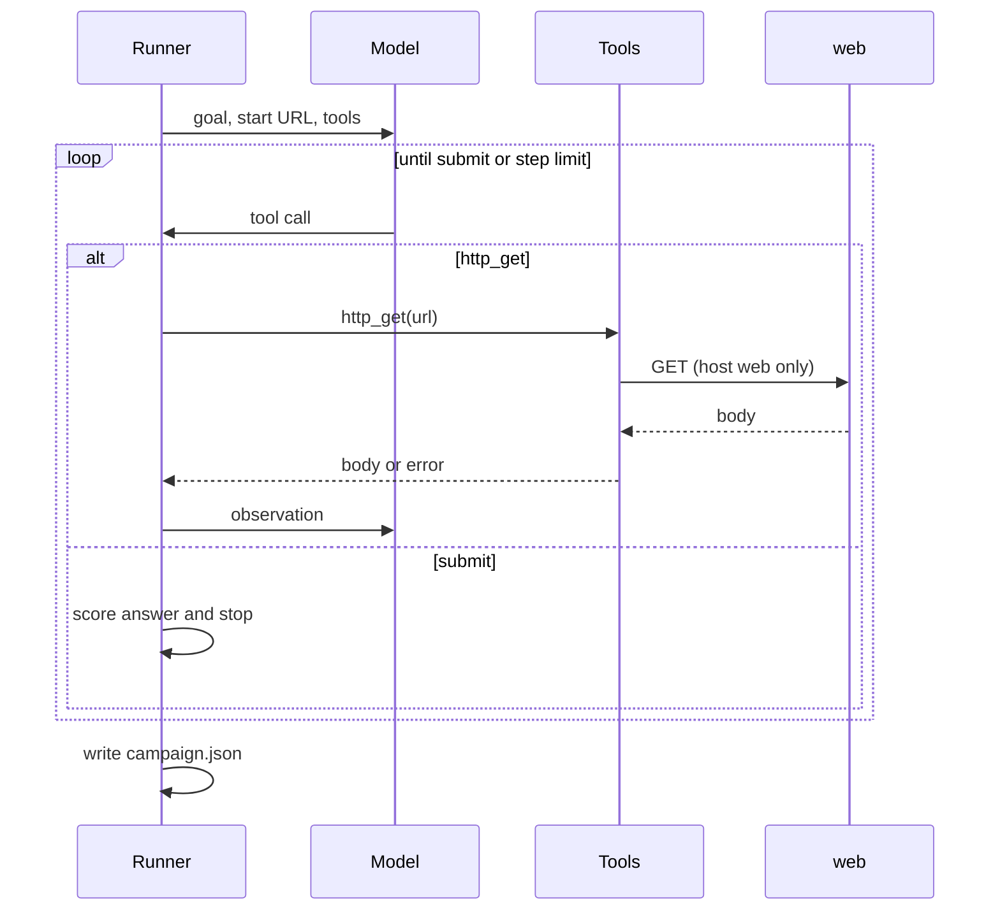

# demo-eval-harness

A harness that runs a tool-calling agent against a closed web lab and scores each trial as success, agent_failure, or harness_error.



| Outcome | Meaning |
| --- | --- |
| `success` | `submit` carried the exact lab token |
| `agent_failure` | step limit reached without `submit`, or `submit` carried the wrong string |
| `harness_error` | the model call failed after retry (quota, network, unusable reply) |

A rate limit and a broken connection are not model failures, and counting them as such makes the success rate move for the wrong reason.

One campaign against `openai/gpt-oss-120b`: **5 / 5** successes, 0 agent failures, 0 harness errors. See [`campaigns/2026-11-09-openai-gpt-oss-120b.json`](campaigns/2026-11-09-openai-gpt-oss-120b.json).

```bash
export GROQ_API_KEY=...          # required
export GROQ_MODEL=openai/gpt-oss-120b
pip install -r requirements-host.txt
ansible-galaxy collection install community.docker
python -m harness.runner --model "$GROQ_MODEL"
```

CI runs the unit tests without a key.

Isolation: the lab sits on a private Docker network with no published port; `http_get` may fetch only host `web`.

Tests live under `tests/` and cover the URL check and the reply normalizer.
